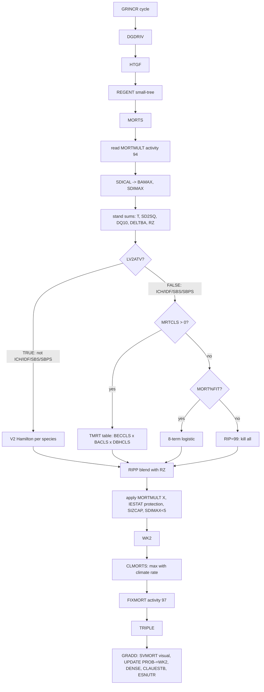
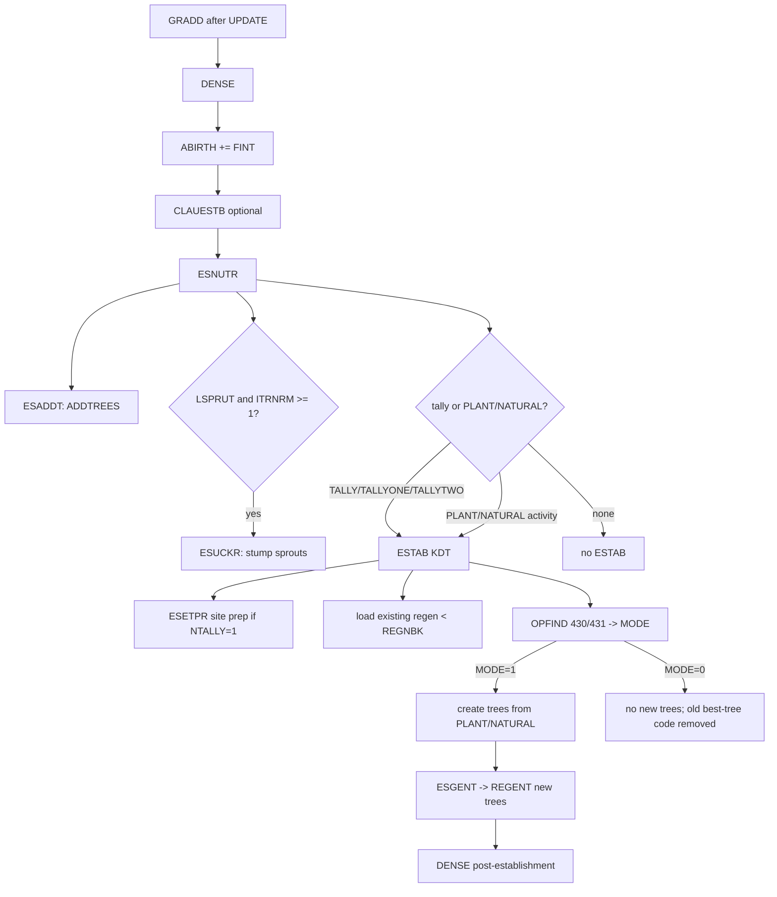

# FVS-BC mortality and ingress/regeneration: source-level code map

**Pinned source:** `/srv/shared-data/gep/ws4/.opencode/tmp/opencode/pyfvs-w23/fvs`
**Revision:** `ef5fa8470cc89f81ca445e7c906e274f200e80fd`
**Build target:** `FVSbc`, driven by `bin/FVSbc_sourceList.txt` (`bin/CMakeLists.txt:21`)
**Scope:** `base`, `vbase`, `canada/bc`, `ie`, `metric`, `strp`, `estb`, `clim`
**Method:** source reading plus a controlled run. Item 10 (the TPH/TPA renderer bug) was confirmed with `NATURAL 1 FD 100 100` and fixed in D9.24; the current wrapper emits trees per hectare.

All paths are relative to the pinned FVS root. Line numbers are 1-based.

**Provenance caveat.** The working tree is not clean against `ef5fa847`: it contains the project's local build patches (for example, additional CWH/CDF/BWBS/CMA/MH `BAMAX` cases in `canada/bc/sitset.f`, added BEC parsing in `canada/bc/habtyp.f`, `SBPS` handling in `canada/bc/regent.f`, and `MCFV` initialisation in `metric/strp/estab.f` / `metric/strp/esuckr.f`). The line numbers below refer to the working tree as read, which is the source the local build uses. The mortality and regeneration control flow described here is not changed by those patches; where a patch does change a BEC case or a growth path, that is called out explicitly.

---

## 0. Executive findings

1. **`MORTS` is not in `base/`.** Each variant supplies it. BC supplies `canada/bc/morts.f`; the only BC call is `canada/bc/grincr.f:529`, after diameter growth (`DGDRIV`, `:431`), height growth (`HTGF`, `:437`) and small-tree growth (`REGENT`, `:443`). `base/svmort.f` is visualization only, called from `base/gradd.f:164`.
2. **BC mortality is a hybrid.** For BEC zones outside ICH/IDF/SBS/SBPS, `BECSET` sets `LV2ATV=.TRUE.` (`canada/bc/becset.f:855-861`) and `MORTS` uses the old V2 Hamilton model with hard-coded `PMSC`, `GMULT`, `REIN`, `POT`. For ICH/IDF/SBS/SBPS it uses the V3 Temesgen table or logistic equation (`canada/bc/morts.f:586-625`).
3. **V3 BEC resolution is zone-level, not site-series.** `MORCON` has only four coefficient labels for four species: `ICH/all`, `IDF/all`, `SBPS/all`, `SBS/all` (`canada/bc/morts.f:366-390`). The matcher tries the full `BEC%PrettyName`, fails, then falls back to `BEC%Zone//'/all '` (`:1047-1077`). Subzone and site series never enter V3 mortality.
4. **The table model has almost no BEC signal.** The tabular model is indexed by two BEC classes (`ICH`/`IDF`, with `SBPS`→IDF and `SBS`→ICH, `SBSdw2`→IDF; `:1099-1107`), five BA classes and four DBH classes (`:207-208`). For seven of nine table species, the IDF block is a literal copy of the ICH block; only FD and PL differ (`:221-227`, `:237-243`, `:269-275`, `:285-291`, `:301-307`, `:333-339`, `:349-355`).
5. **No observed-mortality fitting at start-up.** `CRATET` calls `RCON` (which calls `MORCON`), `DENSE`, `DGDRIV`, `REGENT` (`canada/bc/cratet.f:123-127`, `:169`) but never `MORTS`. Recent dead trees are used only for initial density/volume and then removed (`canada/bc/cratet.f:222-245`). The only mortality call is in `GRINCR` during projection.
6. **Runtime mortality levers are coarse.** `BAMAX` (stand scalar; `canada/bc/initre.f:2791-2800`), `SDIMAX` (species/stand SDI; `vbase/sdical.f:203-216`), `MORTMULT` (species scalar with a DBH window; `canada/bc/initre.f:2616-2665`, `canada/bc/morts.f:533-535,642-660`), and `FIXMORT` (species × DBH × type override; `canada/bc/initre.f:3057-3129`, `canada/bc/morts.f:719-995`). There is no keyword for the actual `FMRT`, `LMRT`, `PMSC`, `IPDG`, `POT`, `REIN` or `GMULT` coefficients.
7. **`MORTMSB` is dead in BC.** It is parsed and stored (`canada/bc/initre.f:5766-5830`; defaults `canada/bc/grinit.f:263-269`), but `canada/bc/morts.f` never reads `QMDMSB`, `SLPMSB`, `EFFMSB`, `DLOMSB`, `DHIMSB` or `MFLMSB`. `base/msbmrt.f` is called only by cr/bm/ut/oc/sn (`cr/morts.f:664` and counterparts), not BC.
8. **Regeneration is keyword-only in the BC build.** The internal “natural regeneration” model has been removed from the compiled STRP `ESTAB`: `STOADJ` is zero and the best-tree block is gone (`metric/strp/estab.f:380-384`, `:540-544`); the natural-regeneration keyword `STOCKADJ` is explicitly disabled (`metric/strp/esin.f:470-476`); `INGROW` is a no-op (`:575-579`); and `strp/esnutr.f` never reads `LINGRW` at all (only `estb/esnutr.f:313` has the automatic-ingrowth branch).
9. **New trees come from `NATURAL`/`PLANT` lines** in an `ESTAB` block, with `DBH=0.1 in`, an optional measured height, otherwise a random height (`metric/strp/estab.f:485-499`), `IESTAT=0` (`:648`), then `ESGENT`/`REGENT` grows them to the end of the cycle (`:690`, `strp/esgent.f:48-62`).
10. **Unit trap (fixed in D9.24).** BC compiles the **metric** reader `metric/strp/esin.f`, where `NATURAL`/`PLANT` stems are **trees per hectare** and are divided by `HAtoACR` (`metric/strp/esin.f:204,252`). Before D9.24, `fresh_fvsbc/ingrowth.py` treated the field as trees per acre and multiplied TPH by `0.404686` (`src/fresh_fvsbc/ingrowth.py:25,278`), delivering 2.471x too few stems. The wrapper now emits TPH; a controlled `NATURAL 1 FD 100 100` run records 100 TPH. R1 is now a regression test.
11. **Sprouting is on by default**, but only EP/AT/AC/OH (`canada/bc/ESPARM.F77:8-10`, `canada/bc/blkdat.f:48-49`), and BC has no species-specific sprout rules: `ESSPRT` default is `PREM*1.0`, `NSPREC` default is `2`, `SPRTHT` default is `0.5+0.5*age` (`vstrp/essprt.f:665-666`, `:1220-1221`, `:1471-1472`).
12. **Climate can enter only through the climate extension** (`CLIMATE`): `CLMORTS` adds mortality (`clim/base/clmorts.f:34-259`), `CLAUESTB` adds establishment (`metric/clim/clauestb.f:34,225-246`), and `CLMAXDEN` can reduce `SDIMAX` (`clim/base/clmaxden.f:29`). Without `LCLIMATE`, all three return immediately.

---

## 1. What is actually compiled for BC

The source list is authoritative; several BC-named files are dead.

| File | In `FVSbc_sourceList.txt`? | Role |
|---|---:|---|
| `canada/bc/morts.f` | yes, line 75 | BC `MORTS` + `MORCON` |
| `canada/bc/grincr.f` | yes, line 66 | BC growth/mortality driver |
| `canada/bc/cratet.f` | yes, line 59 | calls `RCON` → `MORCON`/`REGCON`; no `MORTS` |
| `canada/bc/becset.f` | yes, line 54 | sets `LV2ATV`, V2 habitat parameters |
| `canada/bc/sitset.f` | yes, line 80 | sets `BAMAX`/`SDIDEF` by BEC |
| `canada/bc/regent.f` | yes, line 78 | small-tree growth; V3 site-series `ST_COEF` |
| `canada/bc/estab.f` | **no** | dead in this build |
| `canada/bc/esinit.f` | **no** | dead in this build |
| `canada/bc/esuckr.f` | **no** | dead in this build |
| `canada/bc/natcrz.f` | yes, line 76 | stub, immediately returns (`canada/bc/natcrz.f:11-14`) |
| `ie/rcon.f` | yes, line 88 | calls `DGCONS`, `HTCONS`, `REGCON`, `MORCON`, `CRCONS` (`ie/rcon.f:40-44`) |
| `metric/strp/esin.f` | yes, line 367 | **metric** keyword reader for `ESTAB`; stems are TPH |
| `metric/strp/estab.f` | yes, line 368 | actual BC `ESTAB` |
| `metric/strp/esuckr.f` | yes, line 369 | actual BC sprout creator |
| `strp/esnutr.f` | yes, line 356 | actual BC regen interface |
| `strp/esinit.f` | yes, line 354 | actual BC regen initialization |
| `strp/esgent.f` | yes, line 353 | grows new trees |
| `strp/esfltr.f` | yes, line 352 | flags input “best trees” with `IESTAT` |
| `vstrp/essprt.f` | yes, line 346 | sprout number/height rules; no BC-specific rules |
| `clim/base/clmorts.f` | yes, line 390 | climate mortality |
| `metric/clim/clauestb.f` | yes, line 384 | climate establishment |
| `estb/estab.f` | **no** | full ESTB model, not BC; its `IESTAT=IDSDAT+20` behavior does not apply |

**Consequence for reviewers:** read `metric/strp/estab.f`, `metric/strp/esin.f`, `strp/esnutr.f`, `strp/esinit.f` and `vstrp/essprt.f` for BC regeneration. `canada/bc/estab.f`, `canada/bc/esinit.f` and `canada/bc/esuckr.f` describe a different, uncompiled code path.

---

## 2. Mortality

### 2.1 Entry points and call graph

Mortality is computed once per growth cycle, inside `GRINCR`, before record tripling:

- `canada/bc/grincr.f:431` `CALL DGDRIV`
- `canada/bc/grincr.f:437` `CALL HTGF`
- `canada/bc/grincr.f:443` `CALL REGENT(.FALSE.,1)`
- `canada/bc/grincr.f:529` `CALL MORTS`
- `canada/bc/grincr.f:534-552` optional `TRIPLE`
- `base/gradd.f:164` `CALL SVMORT(0,WK2,IY(ICYC))` (visualization only)
- `base/gradd.f:180` `CALL UPDATE` → `PROB(I)=MAX(0,PROB(I)-WK2(I))` (`base/update.f:71-76`)

`base/grincr.f` is the generic version and wraps the call in `#ifdef FVS_MORTS_WRAP` (`base/grincr.f:549-555`) and two callback hooks (`:539-542`, `:557-561`). **BC uses `canada/bc/grincr.f`, which has neither `MORTS_WRAP` nor `grow_callback`** (`canada/bc/grincr.f:1-2`). Therefore the `GCB_POST_MORT` / `GCB_POST_DG_HTG` callback hooks available in other variants do not fire in the BC build; instrumentation must use the BC file or a scratch build.

`MORCON` is BC’s one-time constant loader. It is reached through `RCON`:

`canada/bc/cratet.f:123` or `:169` → `ie/rcon.f:40-44` → `CALL MORCON` (`canada/bc/morts.f:998`).

`MORCON` is called before projection, after `SITSET`/`BECSET` have set the BEC and `LV2ATV` (`canada/bc/initre.f:185-188`, `:448`).

Flow:



### 2.2 State and units

Inside `MORTS` (`canada/bc/morts.f:436-477`):

- `DBH`, `DG`, `HT` are FVS internal **inches/feet**.
- `PROB` is **trees per acre**.
- `BA` and `BAMAX` are **ft²/acre**.
- `BAX = BA * 0.2295643` is **m²/ha**.
- `SPH = T * 2.471` is **stems/ha**.
- `DX = MAX(2.5, DBH*2.54)` is **cm**, floored at 2.5 cm.
- Table `TMRT` values are annual **proportions** (`FMRT/100`; `:1097-1110`).
- `FINT` is the cycle length in years (`canada/bc/grincr.f:58-60`).

### 2.3 Stand-level density term

`MORTS` computes a 10-year-ahead QMD and a stand-level density term before the tree loop:

```
T      = sum_i PROB_i
SD2SQ  = sum_i PROB_i * (D_i^2 + 2 D_i (DG_i/BARK_i) + (DG_i/BARK_i)^2)
DQ10   = sqrt(SD2SQ / T)
DELTBA = 0.005454154 * DQ10^2 * T - BA
BA10   = BA + ((BAMAX - BA)/BAMAX) * DELTBA
TB     = BA10 / (0.005454154 * DQ10^2)
TTB    = (T - TB)/T, clamped <= 0.9999
RZ     = 1 - (1 - TTB)^0.1
```

References: `canada/bc/morts.f:436-462` (`T`/`SD2SQ` at 436-447, `DQ10` at 448, `DELTBA` at 449, `BA10` at 455, `TB` at 456, `TTB`/`RZ` at 460-462). `AVED`, `BAX` and `SPH` follow at `:466-477`.

The `0.1` exponent hard-codes a 10-year annualization even if `FINT` is not 10. The final compounding uses `FINT` (`:660`), so `FINT ≠ 10` makes the density term internally inconsistent. This is a structural issue, not a calibration option.

Also note the density term needs positive `DELTBA`. With `DG = 0`, `DQ10 = QMD`, `DELTBA ≈ 0`, `TTB = 0`, `RZ = 0`, and the `RIPP` blend falls back to the individual-tree `RIP`. A stagnant overstocked stand therefore receives no extra density-dependent mortality from `RZ`; only `RIP` applies (`:448-462`, `:632-637`).

### 2.4 V2 path: `LV2ATV = TRUE`

`LV2ATV` is true for BEC zones outside ICH/IDF/SBS/SBPS (`canada/bc/becset.f:855-861`). For each species, `MORTS` loads `GMULT(1:2)`, `REIN(1:2)` and `B5 = PMSC(ISPC)` (`canada/bc/morts.f:502-509`). `GMULT_C`/`REIN_C` were computed once in `MORCON` from `IPDG(ITYPE,IFOR)`, `POT`, and `V2SEICOR` (`:1008-1032`).

Per tree (`canada/bc/morts.f:554-578`):

```
RELDBH = D / AVED
if D <= 0.5: D = 0.5
DGT = WK1 / OLDFNT
... floors on DGT for small trees ...
G = WK1 / (BARK * OLDFNT)
if WK1/OLDFNT < DGT: G = DGT / BARK
if (ICYC == 1 or WK1 == 0) and DG > 0.5: G = DG/(BARK*10)
IP = 1; if D <= 5: IP = 2
G = G * GMULT(IP)
RIP = 2.76253
    + 0.222310*sqrt(D)
    - 0.0460508*sqrt(BA)
    + 11.2007*G
    - 0.554421/D
    + B5
    + 0.246301*RELDBH
    + 6.07129*G/D
clamp RIP to [-70, 70]
RIP = 1/(1+exp(RIP))          ! a small number = mortality probability
RIP = RIP * REIN(IP)
```

Hard-coded coefficients are at `canada/bc/morts.f:572-573`; `PMSC` at `:123-125`; `IPDG`/`IPDG2`/`POT` at `:127-196`; `GMULT/REIN` formulas at `:1012-1030`.

### 2.5 V3 table path: `LV2ATV = FALSE`, `MRTCLS > 0`

For ICH/IDF/SBS/SBPS, species are mapped to table classes (`canada/bc/morts.f:510-530`):

| FVS species | Code | `MRTCLS` |
|---|---:|---|
| PW | 1 | `MRT_PW` |
| LW | 2 | `MRT_LW` |
| FD, OC | 3, 14 | `MRT_FD` |
| BG, BL | 4, 9 | `MRT_BG` |
| HW | 5 | `MRT_HW` |
| CW | 6 | `MRT_CW` |
| PL | 7 | `MRT_PL` |
| SE | 8 | `MRT_SE` |
| PY | 10 | `MRT_PY` |
| EP, AT, AC, OH | 11, 12, 13, 15 | 0 → logistic |

The table is filled in `MORCON`:

```
BECCLS = 1 (ICH)
if BEC%Zone contains 'IDF': BECCLS = 2
if BEC%Zone contains 'SBPS': BECCLS = 2
if BEC%Zone contains 'SBS':  BECCLS = 1
if BEC%PrettyName contains 'SBSdw2': BECCLS = 2
TMRT(i,j,k) = FMRT(BECCLS,i,j,k)/100
```

References: `canada/bc/morts.f:1099-1110`; `FMRT` data at `:213-356`; `MRT_*` parameters at `canada/bc/BCPLOT.F77:10-19`.

Per tree (`canada/bc/morts.f:582-601`):

```
DX = max(2.5, D*2.54)
RELDBH = DX / max(2.5, AVED*2.54)
DBHCLS = first j in [1,2,3] with DX <= DBHBRK(j), else 4
BACLS  = first i in [1,2,3,4] with BAX <= BABRK(i), else 5
RIP = TMRT(MRTCLS, BACLS, DBHCLS)
```

with `DBHBRK = 10, 25, 40 cm` and `BABRK = 20, 30, 40, 50 m²/ha` (`canada/bc/morts.f:207-208`). BA class is computed once per stand at `:486-495`.

**Critical structural point:** the IDF table is a literal copy of the ICH table for PW, LW, BG, HW, CW, SE and PY. Only FD and PL have distinct ICH/IDF values. So, for those seven species, changing BEC from ICH to IDF changes nothing. `SBPS` maps to IDF and `SBS` maps to ICH, so the effective BEC signal is only two classes, and only for FD/PL.

### 2.6 V3 logistic path: `MRTCLS = 0`, `MORT%FIT`

For EP, AT, AC and OH, `MRTCLS = 0` and the code uses `MORT%` coefficients loaded by `MORCON` (`canada/bc/morts.f:610-625`):

```
BAL = (1 - PCT/100) * BAX          ! m2/ha in larger trees
RIP = MORT%CON(ISPC)
    + MORT%INVDBH(ISPC)/DX
    + MORT%DBH(ISPC)*DX
    + MORT%DBHSQ(ISPC)*DX*DX
    + MORT%RDBH(ISPC)*RELDBH
    + MORT%BAL(ISPC)*BAL
    + MORT%SQRTBA(ISPC)*sqrt(BAX)
    + MORT%SPH(ISPC)*SPH
clamp RIP to [-70,70]
RIP = 1 - 1/(1+exp(RIP))           ! mortality probability
```

If `MORT%FIT(ISPC)` is false, `RIP = 99.0` (`:621-623`), which is effectively certain death over a normal cycle. With the shipped `LMRT` data this should not happen for the four species in ICH/IDF/SBS/SBPS, but it is the fallback and should be instrumented.

The coefficients are one set, used for all four BEC labels (`canada/bc/morts.f:366-390`):

```
LMRT(1): SPP = (11,12,13,15)   ! EP, AT, AC, OH
PrettyName = 'ICH/all', 'IDF/all', 'SBPS/all', 'SBS/all', ...
COEF = (-2.774444, 0.684626, -0.180211, 0.004550,
        -0.634960, 0.063153, -0.276905, 0.000100)
```

`MORCON` tries the full BEC name first, then `BEC%Zone//'/all '` (`:1047-1077`). Because the stored names are `ICH/all` etc., the first attempt cannot match a full name like `ICHmw2/01`; the fallback always wins. The `MORT%PrettyName` field is assigned (`:1050`) but never used elsewhere.

### 2.7 Blend, multipliers and limits

For every tree, after `RIP` is chosen (`canada/bc/morts.f:630-679`):

```
RIPP = BA*RZ
if BA <= BAMAX: RIPP = RIPP + (BAMAX-BA)*RIP
RIPP = RIPP / BAMAX
RIPP = max(RIPP, RIP)
RIPP = min(RIPP, 1.0)

X = 1.0
if D1 <= D < D2: X = XMORT
if IESTAT > 0:
    if IY(ICYC) >= IESTAT: IESTAT = 0
    XCHECK = clamp((IESTAT - IY(ICYC))/FINT, 0, 1)
    X = X * (1 - XCHECK)

WKI = P * (1 - (1 - RIPP)^FINT) * X

if (D + G) >= SIZCAP(ISPC,1) and SIZCAP(ISPC,3) != 1:
    WKI = max(WKI, P * SIZCAP(ISPC,2) * FINT/10)

if SDIMAX < 5: WKI = P
WK2(I) = min(WKI, P)
```

References: blend `:632-637`; multiplier `:642-643`; `IESTAT` `:649-654`; `WKI` `:660`; `SIZCAP` `:662-670`; `SDIMAX<5` `:673-678`; clamp `:671`.

Notes:

- `RIPP` is a **periodic mortality probability**, not an annual rate. `MORTMULT` multiplies this periodic probability (`X` at `:660`), not the annual hazard. A multiplier of 2 does not exactly double the annual rate; it doubles the periodic probability, and then `WKI` is capped at `P`.
- `IESTAT` is the only “new tree protection” term. Input advance regeneration flagged by `ESFLTR` can receive `IESTAT = IDSDAT+20` (`strp/esfltr.f:164-166`); trees created by the compiled STRP `ESTAB` receive `IESTAT=0` (`metric/strp/estab.f:648`). The 20-year protection therefore does not apply to our `NATURAL` ingrowth.
- `SIZCAP` defaults to `999, 1, 0, 999` (`canada/bc/grinit.f:131-134`), so the size-cap branch is inactive unless a keyword sets it. When active, it can force a minimum mortality rate `SIZCAP(ISPC,2) * FINT/10`.
- `SDIMAX < 5` is a climate kill switch: all trees die (`:673-678`). `SDIMAX` is the BA-weighted maximum SDI returned by `SDICAL` (`:430`); `CLMAXDEN` can reduce it under climate change (`vbase/sdical.f:216`).

### 2.8 Climate mortality (`CLMORTS`)

`MORTS` always calls `CLMORTS` (`canada/bc/morts.f:711`). `CLMORTS` returns immediately unless `LCLIMATE` is true (`clim/base/clmorts.f:34`). When active:

- It reads a `CLMORT`/activity 2801 option for species multipliers `CLMRTMLT1/2` (`:36-51`).
- It computes species viability from `ATTRS` and `SPCALIB` (`:63-129`).
- It computes a climate-transfer-distance mortality from six climate attributes (`:130-238`).
- It uses `WK2 = max(WK2, PROB*DMORT)` (`:257-259`), so climate can only increase mortality; it never reduces the base FVS rate.

`LCLIMATE` is set by the `CLIMATE` reader: `LCLIMATE = NATTRS > 0 .AND. NYEARS > 0` (`metric/clim/clin.f:93`). No climate data, no effect.

### 2.9 `FIXMORT`

`FIXMORT` is activity 97, parsed at `canada/bc/initre.f:3057-3129` (type codes documented at `:3103-3124`), applied at `canada/bc/morts.f:719-995`. For each species/DBH window, type code `IP` selects (`:975-987`):

| IP | Type | Effect |
|---:|---|---|
| 1 | 0 | replace: `WK2 = PROB * rate` |
| 2 | 1 | add: `WK2 = WK2 + max(0, PROB-WK2)*rate` |
| 3 | 2 | max: `WK2 = max(WK2, PROB*rate)` |
| 4 | 3 | multiply: `WK2 = min(PROB, WK2*rate)` |

`FIXMORT` also supports point and size concentration (`KPOINT`, `KBIG`; `canada/bc/morts.f:776-955`). This is a manual override, not a fitted model; it has no covariates and no site/BEC response.

### 2.10 Mortality pseudocode

```fortran
SUBROUTINE MORTS
  ! 1. Read MORTMULT (activity 94) into XMMULT(ISPC), XMDIA1/2(ISPC)
  CALL OPFIND(1, 94, NTODO)
  ... XMMULT = PRM(2); XMDIA1 = PRM(3); XMDIA2 = PRM(4) ...

  ! 2. Convert percent PMSDIL/PMSDIU to proportions
  IF (PMSDIL > 1) PMSDIL = PMSDIL/100
  IF (PMSDIU > 1) PMSDIU = PMSDIU/100

  IF (ITRN <= 0) GOTO 100

  ! 3. Stand-level density term
  CALL SDICAL(0, SDIMAX)                  ! may reset BAMAX via SDIDEF
  T = 0; SD2SQ = 0
  DO I = 1, ITRN
     P = PROB(I); D = DBH(I); G = DG(I)/BRATIO(ISP(I),D,HT(I))
     SD2SQ = SD2SQ + P*(D*D + 2*D*G + G*G)
     T = T + P
  ENDDO
  DQ10 = SQRT(SD2SQ/T)
  DELTBA = 0.005454154*DQ10*DQ10*T - BA
  BA10 = BA + ((BAMAX-BA)/BAMAX)*DELTBA
  TB = BA10/(0.005454154*DQ10*DQ10)
  TTB = (T-TB)/T; IF (TTB > 0.9999) TTB = 0.9999
  RZ = 1 - (1-TTB)**0.1

  AVED = SUM(DBH*PROB)/SUM(PROB)
  BAX  = BA * 0.2295643                    ! m2/ha
  SPH  = T  * 2.471                        ! stems/ha
  BACLS = first BA class from BABRK [20,30,40,50], else 5

  ! 4. Species loop
  DO ISPC = 1, MAXSP
     I1 = ISCT(ISPC,1); I2 = ISCT(ISPC,2); IF (I1 <= 0) CYCLE
     IF (LV2ATV) THEN
        GMULT(1:2) = GMULT_C(1:2,ISPC); REIN(1:2) = REIN_C(1:2,ISPC)
        B5 = PMSC(ISPC)
     ELSE
        MRTCLS = species table class (or 0)
     ENDIF
     XMORT = XMMULT(ISPC); D1 = XMDIA1(ISPC); D2 = XMDIA2(ISPC)

     ! 5. Tree loop
     DO I3 = I1, I2
        I = IND1(I3); P = PROB(I); WK2(I) = 0
        IF (P <= 0) CYCLE
        D = DBH(I); BARK = BRATIO(ISPC,D,HT(I))
        IF (LV2ATV) THEN
           ! Hamilton V2, see section 2.4
           RIP = ...
        ELSE
           DX = MAX(2.5, D*2.54)
           RELDBH = DX/MAX(2.5, AVED*2.54)
           IF (MRTCLS > 0) THEN
              DBHCLS = first DBH class from DBHBRK [10,25,40], else 4
              RIP = TMRT(MRTCLS, BACLS, DBHCLS)
           ELSE IF (MORT%FIT(ISPC)) THEN
              BAL = (1 - PCT(I)/100)*BAX
              RIP = MORT%CON + MORT%INVDBH/DX + MORT%DBH*DX
                  + MORT%DBHSQ*DX*DX + MORT%RDBH*RELDBH
                  + MORT%BAL*BAL + MORT%SQRTBA*SQRT(BAX)
                  + MORT%SPH*SPH
              RIP = MAX(-70, MIN(70, RIP))
              RIP = 1 - 1/(1+EXP(RIP))
           ELSE
              RIP = 99
           ENDIF
        ENDIF

        ! 6. Density blend
        RIPP = BA*RZ
        IF (BA <= BAMAX) RIPP = RIPP + (BAMAX-BA)*RIP
        RIPP = RIPP/BAMAX
        RIPP = MAX(RIPP, RIP)
        RIPP = MIN(RIPP, 1)

        ! 7. Modifiers
        X = 1
        IF (D >= D1 .AND. D < D2) X = XMORT
        IF (IESTAT(I) > 0) THEN
           IF (IY(ICYC) >= IESTAT(I)) IESTAT(I) = 0
           XCHECK = CLAMP((IESTAT(I)-IY(ICYC))/FINT, 0, 1)
           X = X*(1-XCHECK)
        ENDIF

        WKI = P*(1-(1-RIPP)**FINT)*X
        G   = (DG(I)/BARK)*(FINT/10)
        IF ((D+G) >= SIZCAP(ISPC,1) .AND. SIZCAP(ISPC,3) != 1) THEN
           WKI = MAX(WKI, P*SIZCAP(ISPC,2)*FINT/10)
        ENDIF
        IF (SDIMAX < 5) WKI = P
        WK2(I) = MIN(WKI, P)
     ENDDO
  ENDDO

100 CONTINUE
  CALL CLMORTS                          ! optional climate max
  CALL OPFIND(1, 97, NTODO)             ! FIXMORT override
  ... apply FIXMORT types 0..3 ...
  RETURN
```

### 2.11 BC versus base and other variants

| Aspect | BC | Base/other |
|---|---|---|
| `MORTS` | `canada/bc/morts.f` | variant-specific; no `base/morts.f` |
| Driver | `canada/bc/grincr.f` | `base/grincr.f` with `MORTS_WRAP` and callbacks |
| BEC switch | `LV2ATV` in `BECSET` (`becset.f:855-861`) | not present |
| V3 table/logistic | only ICH/IDF/SBS/SBPS | not present in IE etc. |
| V2 site model | EP/AT/AC/OH `LMRT`; all species `PMSC` | IE uses Hamilton for all |
| `MORCON` | BC-specific, called through `ie/rcon.f` | IE’s own `MORCON` |
| `MORTMSB` | parsed, never used | used by cr/bm/ut/oc/sn |
| `IESTAT` for new trees | `0` in STRP `ESTAB` | `IDSDAT+20` in `estb/estab.f:1269` |

### 2.12 Hard-coded coefficients, dead code, missing covariates

**Hard-coded coefficients / data**

- `PMSC` species constants: `canada/bc/morts.f:123-125`.
- Hamilton coefficients: `:572-573`.
- `GMULT`/`REIN` constants `.90`, `2.50`, `1.605`, `.06821`, `.86610`, `20`, `1`: `:1012-1030`.
- `FMRT` table: `:213-356`.
- `LMRT` logistic coefficients: `:366-390`.
- `DBHBRK` 10/25/40 cm; `BABRK` 20/30/40/50 m²/ha: `:207-208`.
- `RZ` exponent `0.1`: `:462`.
- `SIZCAP` defaults `999, 1, 0, 999`: `canada/bc/grinit.f:131-134`.
- `PMSDIL=55`, `PMSDIU=85`: `canada/bc/grinit.f:252-253`.
- `BAMAX` default table: `canada/bc/sitset.f:46-368`.
- `REGNBK=2.999 in`: `canada/bc/blkdat.f:142`.

**Dead or ineffective in the BC mortality path**

- `MORTMSB`: parsed at `canada/bc/initre.f:5766-5830`, stored in `VARCOM` (`common/VARCOM.F77:24`), never read by `canada/bc/morts.f`; `MSBMRT` is called only by cr/bm/ut/oc/sn (`cr/morts.f:664`).
- `LLTDGOK` condition in the logistic branch is commented out: `canada/bc/morts.f:611` (`! IF (MORT%FIT(ISPC) .AND. LLTDGOK(ISPC))`).
- `MORT%PrettyName`: assigned at `:1050`, never used.
- `P_SS=30` slots but only four names are filled: `:104-115`, `:366-390`.
- `RIP=99` fallback: `:621-623`; unreachable for normal BC species/zones but lethal if a BEC string or species mapping changes.
- `canada/bc/natcrz.f` is a stub (`:11-14`), not a mortality path.
- `canada/bc/estab.f`/`esinit.f`/`esuckr.f` are dead for the BC build; do not use them to explain BC behavior.

**Missing covariates in the core V3 mortality equations**

- Site index (`SITEAR`) is not read in `canada/bc/morts.f` at all.
- Elevation, slope, aspect are not read in `MORTS`; they enter only V2 habitat through `ITYPE`/`IPDG` and growth through `V2SEICOR`.
- Crown ratio (`ICR`), damage, defect, stand age are not read.
- Climate is not read unless `LCLIMATE` (section 2.8).
- Competition is only `BA`, `BAL = (1-PCT/100)*BAX`, `SPH`, `RELDBH`; no spatial neighbour, no species-mixture term beyond BA-weighted SDI.
- Disturbance history enters only through `IESTAT` (input advance regeneration) and `BAMAX`/`SDIDEF` defaults.

---

## 3. Ingress / regeneration

### 3.1 Entry points and call graph

`ESNUTR` is the regeneration interface. It is called from `GRADD`, after mortality is applied and after post-mortality `DENSE`:

- `base/gradd.f:180` `CALL UPDATE`
- `base/gradd.f:192` `CALL DENSE`
- `base/gradd.f:204-206` increment `ABIRTH`
- `base/gradd.f:223` `CALL CLAUESTB` (optional climate establishment)
- `base/gradd.f:229` `CALL ESNUTR`
- `base/gradd.f:235` `CALL SVESTB(1)` (visualization)
- `base/gradd.f:244` `CALL DENSE` (post-establishment)

Inside `ESNUTR` (`strp/esnutr.f`):

- `:46` `CALL ESADDT(1)` — external `ADDTREES`/database trees.
- `:48-94` process `SPECMULT`, `STOCKADJ`, `HTADJ` activities.
- `:112-141` sprouting: if `LSPRUT` and `ITRNRM >= 1`, `CALL ESUCKR`.
- `:150-283` tally/`PLANT`/`NATURAL` scheduling.
- `:321` `CALL ESTAB(KDT)`.
- `:342` delete remaining unconsumed tallies.

`ESTAB` (`metric/strp/estab.f`) then:

- `:86` `CALL DBCHK(DEBUG,'ESTAB',5,ICYC)`
- `:90` `ITRNIN = ITRN+1`
- `:200-280` site preparation (`ESETPR`, `ESPREP`) for `NTALLY=1`
- `:285-301` `MODE = 1` if `OPFIND(2, [430,431])` finds `PLANT`/`NATURAL` activities
- `:329-344` plot loop
- `:420-535` create records from `PLANT`/`NATURAL`
- `:590-658` add records to the tree list
- `:690` `CALL ESGENT(ITRNIN)`
- `:693-702` crown width and `ABIRTH += GENTIM`

`ESGENT` (`strp/esgent.f`):

- `:43-44` `IREC1=ITRN`, `SPESRT`
- `:48` `CALL REGENT(.TRUE.,ITRNIN)`
- `:49-66` update `HT`, `DBH`, `DG`; cap at `HHTMAX`
- `:71-72` height summary

`REGNBK = 2.999 in` is the overstory threshold (`canada/bc/blkdat.f:142`). `DENSE` excludes trees below `REGNBK` from overstory BA/CCF/point BA (`base/dense.f:210-218`) but still includes them in total `BA` and `PCT` (`:186-192`, `:272-274`).

Flow:



### 3.2 When regeneration is active

There are four distinct entry paths:

1. **Sprouting** — every cycle after a removal, if `LSPRUT` is true (default) and `ITRNRM >= 1` (`strp/esnutr.f:112-119`). `ITRNRM` is filled by `ESTUMP` when trees are cut (`vbase/cuts.f:1713`; `strp/estump.f:68-78`).
2. **`PLANT` / `NATURAL` keywords** — `ESTAB` is called when an activity of code 430 (`PLANT`) or 431 (`NATURAL`) is scheduled for the cycle, even without a tally (`strp/esnutr.f:265-278`). This is the path our bundle uses.
3. **Tallies** — `TALLY`, `TALLYONE`, `TALLYTWO` activities (427/428/429) trigger `ESTAB` when their date matches (`strp/esnutr.f:150-263`). But if `ESTAB` finds no `PLANT`/`NATURAL`, `MODE=0` and no trees are created (because the natural model is gone; section 3.5).
4. **Automatic ingrowth** — **absent** from `strp/esnutr.f`. `LINGRW` is initialized false (`strp/esinit.f:49`) and set false by `NATURAL` (`metric/strp/esin.f:257`), but `strp/esnutr.f` has no `IF(LINGRW)` block at all; only `estb/esnutr.f:313` has it. `INGROW` is a no-op (`metric/strp/esin.f:575-579`).
5. **`ADDTREES`** — `ESADDT` can add trees/options from an external program or file (`strp/esaddt.f:32-120`); independent of `ESTAB`.
6. **Climate establishment** — `CLAUESTB` adds `NATURAL` activities (code 431) when `LCLIMATE` and `LAESTB` are true and stocking is below `AESTOCK` (`metric/clim/clauestb.f:225-246`). Not active without climate data.

### 3.3 The compiled BC `ESTAB` is the STRP model, not `canada/bc/estab.f`

The build uses `metric/strp/estab.f` (`bin/FVSbc_sourceList.txt:368`). The BC-named `canada/bc/estab.f`, `canada/bc/esinit.f` and `canada/bc/esuckr.f` are **not** in the list. This is not cosmetic: the ESTB model has a different `IESTAT` policy (`estb/estab.f:1267-1269` sets `IESTAT=IDSDAT+20`) and a different natural-regeneration structure. The STRP `ESTAB` sets `IESTAT=0` for every tree it creates (`metric/strp/estab.f:648`).

### 3.4 `NATURAL` / `PLANT` keyword path

The keyword reader is `metric/strp/esin.f`. `NATURAL` is option 3 (`:250-258`), `PLANT` is option 2 (`:202-206`). Both share the code at `1205`.

**Fields** (FVS ten-column fields):

| Field | `PLANT`/`NATURAL` meaning | Metric reader conversion |
|---:|---|---|
| 1 | date or cycle | `IDT = IFIX(ARRAY(1))`, default 1 (`metric/strp/esin.f:208-209`) |
| 2 | species code | `SPDECD` (`:222-224`) |
| 3 | stems | **`ARRAY(3) = ARRAY(3)/HAtoACR`** (`:204`, `:252`) → TPH input becomes TPA internally |
| 4 | % survival | clamped 0.001–100, default 100 (`:230`) |
| 5 | age | passed through; `ESTAB` clamps `<0.5 → 2.0`, `>10 → 10.0` (`estab.f:445-447`) |
| 6 | average height | metric reader multiplies by `MtoFT` (`:205`, `:253`); 0 means “random” |
| 7 | shade code | 0 none, 1 shade-tolerant, 2 shade-intolerant (`estab.f:452-455`) |

**Stems unit trap (fixed in D9.24).** In the non-metric `strp/esin.f`, the field is `TREES/ACRE` and there is no conversion (`strp/esin.f:231-235`). In the metric `metric/strp/esin.f`, the echo format says `TREES/HA` (`:241-243`) and the code divides by `HAtoACR=2.471` (`:252`). The BC build compiles the metric file (`bin/FVSbc_sourceList.txt:367`). Therefore the BC `NATURAL`/`PLANT` stems field is **TPH**, not TPA. The wrapper was corrected in D9.24; the following is the pre-fix audit trail.

`fresh_fvsbc/ingrowth.py` says the opposite and multiplies by `0.404686`:

- docstring: “NATURAL reads trees per acre; 1 TPH = 0.404686 TPA” (`src/fresh_fvsbc/ingrowth.py:8-11`)
- constant: `TPH_TO_TPA: float = 0.404686` (`:25`)
- conversion: `tpa = tph * TPH_TO_TPA` (`:278`), then `Keyword("NATURAL", (..., f"{tpa:.1f}", "100.0"))` (`:281-283`)

At source level, a desired rate of `R` TPH/yr over `L` years should be written as `R*L` (TPH). The current renderer writes `R*L*0.404686` and FVS divides it by `2.471`, so the internal TPA is `R*L*0.404686/2.471 = R*L/6.107`, a factor `2.471` below the intended TPA (`R*L/2.471`). This is a direct under-supply of ingrowth, not a subtle bias. Test R1 below.

The same unit ambiguity exists in `CLAUESTB`, which passes `POTESTAB` as “trees/acre” into activity 431 (`metric/clim/clauestb.f:231-237`), while the metric reader treats field 3 as TPH. If climate establishment is used, check this too.

**Tree creation** (`metric/strp/estab.f:443-527`, `:590-658`):

```
IPNSPE = IFIX(PRMS(1))
PTREE  = (PRMS(2) * (PRMS(3)/100)) / DUPNPT
TRAGE  = PRMS(4); if TRAGE < 0.5: TRAGE = 2.0; if >10: 10.0
AGEPL(ITODO) = TRAGE
DELAY  = IPYEAR - (KDT+1-FINT)
TREEHT = PRMS(5)
ISHADE = IFIX(PRMS(6))
...
if TREEHT >= 0.1:
    HHT = TREEHT
    HHT = EXP(BACHLO(LOG(HHT), 0.5, ESRANN))   ! lognormal, clipped [0.5H, 2H]
else:
    HHT = 1.0 + BACHLO(0.5, 0.25, ESRANN)       ! random ~0.5 ft, clipped [0,1.5]
    HHT = HHT + HTADJ(IPNSPE)
    HHT = MAX(HHT, XMIN(IPNSPE))
if HHT > HHTMAX(IPNSPE): HHT = HHTMAX(IPNSPE)

IBRKUP = INT(PTREE/10 + 1)
DO II = 1, IBRKUP
   ITRN = ITRN + 1
   PROB(ITRN) = PTREE/IBRKUP
   DBH(ITRN)  = 0.1
   HT(ITRN)   = HHT
   ABIRTH(ITRN) = AGEPL(JJ)
   IESTAT(ITRN) = 0
   ICR(ITRN) = 0
   WK4(ITRN) = HTIMLT(ITPP+JJ)
   PTBALT(ITRN) = PTBAA(NNID)
ENDDO
```

References: `PTREE`/`TRAGE`/`DELAY`/`TREEHT`/`ISHADE` at `metric/strp/estab.f:443-455`; height at `:485-499`; `AGEPL`/`HTIMLT` at `:518-527`; record creation at `:590-658`; `IESTAT=0` at `:648`.

`GENTIM` and `HTIMLT` are computed at `:327-328` and `:518-522`:

```
GENTIM = MAX(0, FINT - 5.0)
...
if FINT-DELAY < 5: GENTIM = 0
else:               GENTIM = FINT-DELAY-5.0
FTEMP  = MIN(TRAGE, GENTIM)
HTIMLT = FTEMP/(GENTIM+0.0001)
AGEPL  = FINT-DELAY+TRAGE
```

`HTIMLT` is stored in `WK4` and used by `ESGENT` to scale height growth (`strp/esgent.f:52`). If the `NATURAL` line omits age and height, the new tree gets age 2, a random height, and `HTIMLT` derived from `TRAGE`/`GENTIM`; this is a stochastic initial condition that should be controlled in calibration.

**Shade code** (`metric/strp/estab.f:456-473`): if shade code is 1 or 2, `PTREE` is multiplied by a plot BA ratio:

```
if ISHADE == 1: PTREE = PTREE * NPTIDS * FTEMP / SUM1
if ISHADE == 2: PTREE = PTREE * NPTIDS * (SUM1/FTEMP) / SUM2
```

where `FTEMP = MAX(BAA, 1)` is the plot BA in larger trees and `SUM1`/`SUM2` are computed at `:305-321`. The bundle passes no shade code (field 7 omitted), so `ISHADE=0` and this competition response is inactive.

### 3.5 The internal natural-regeneration model is absent

This is the most important regeneration finding after the unit trap. In the compiled STRP `ESTAB`:

- `MODE=0` by default; `MODE=1` only if `OPFIND` finds `PLANT`/`NATURAL` activities (`metric/strp/estab.f:285-301`).
- `STOADJ` is initialized to 0 (`strp/esinit.f:47`) and `NATURAL` explicitly sets it to 0 (`metric/strp/esin.f:255`). `STOCKADJ` is a no-op: it prints “PREDICTION OF NATURAL REGENERATION DISABLED” and returns (`metric/strp/esin.f:470-476`).
- The old “probability of stocking” block is skipped by `IF(STOADJ.LT.0.0001) GO TO 137` (`metric/strp/estab.f:380`).
- The old “best tree” block is gone: `IF(STOADJ.LT.0.0001) GO TO 229` and the comment “PICKING BEST TREES USED TO BE DONE HERE” (`metric/strp/estab.f:540-544`).
- `BESTPA`, `PASTPA`, `NEWTPP`, `TOTTPA` are bookkeeping for the report (`:590-606`, `:717-720`), not drivers of new trees.
- `OCURHT` and `OCURNF`, the habitat/forest occurrence probability arrays, are zeroed and explicitly “NOT USED IN STRP VERSION” (`canada/bc/blkdat.f:64-69`). They are printed only in debug (`metric/strp/estab.f:376-378`).
- `LINGRW` is never read in `strp/esnutr.f`; there is no automatic-ingrowth branch. `INGROW` is a no-op (`metric/strp/esin.f:575-579`). `NOINGROW` just sets a flag that is not read.
- `AUTALLY` is a no-op (`metric/strp/esin.f:592-596`), and `strp/esnutr.f` has no automatic-tally block (only `estb/esnutr.f:262-291` has it).

Therefore, in the BC build, **the only way to create new trees other than sprouts, `ADDTREES`, or climate establishment is a `PLANT`/`NATURAL` keyword line.** There is no seed source, no dispersal, no parent-tree effect, no species establishment probability, no climate response, and no density-dependent recruitment inside `ESTAB`. The rate is exogenous.

### 3.6 Sprouting

- `ESNUTR` calls `ESUCKR` when `LSPRUT` and `ITRNRM >= 1` (`strp/esnutr.f:112-119`).
- `ESTUMP` is called from `vbase/cuts.f:1713` for each removed tree; it stores stump DBH class, species and removed probability in `DSTUMP`, `ISHOOT`, `PRBREM`, `JSHAGE` (`strp/estump.f:68-78`).
- `ESUCKR` decodes the stumps, processes `SPROUT` options (activity 450), calls `NSPREC` for the number of sprout records, `ESSPRT` for the probability, and `SPRTHT` for height (`metric/strp/esuckr.f:102-152`, `:218-296`).
- BC’s sprouting species are EP, AT, AC, OH (`ISPSPE = 11,12,13,15`; `canada/bc/blkdat.f:48-49`; `NSPSPE=4`; `canada/bc/ESPARM.F77:8-10`).
- BC has no species-specific rules in the generic `vstrp/essprt.f`: `ESSPRT` falls through to `PREM = PREM*1.0` (`:665-666`), `NSPREC` falls through to `NMSPRC = 2` (`:1220-1221`), and `SPRTHT` falls through to `HTSPRT = 0.5 + 0.5*IAG` (`:1471-1472`). `ESASID('BC')` returns aspen index 12 (`:681-682`), which is used for the aspen-specific `ASSPTN` path (`metric/strp/esuckr.f:226-232`).
- Sprouts are created with `IMC=2`, `DBH=0.1` or height-derived, `IESTAT=0` (`metric/strp/esuckr.f:262-314`).

In an unharvested PSP stand, `ITRNRM=0`, so sprouting is irrelevant. In a managed stand, it is a second, uncalibrated recruitment source.

### 3.7 Climate establishment (`CLAUESTB`)

`CLAUESTB` is called before `ESNUTR` (`base/gradd.f:223`). It returns immediately unless `LCLIMATE` (`metric/clim/clauestb.f:34`). When active:

- It computes maximum trees from `SDICAL` and current QMD (`:52-70`).
- It computes a stocking-based `PTREES` (`:58-70`).
- It ranks species by climate viability and assigns `POTESTAB` (`:72-140`).
- It returns if `TPROB > TMAXTRS*AESTOCK*.01` (`:184-186`).
- It adds `NATURAL` activities (code 431) for species with positive `POTESTAB` (`:225-246`) and calls `OPINCR`.

This is not a site/BEC calibration path; it is a climate-viability path and only runs with climate data.

### 3.8 What happens after establishment

1. `ESTAB` adds records at `DBH=0.1 in`, `HT=HHT`, `PROB=PTREE/IBRKUP`, `ABIRTH`, `IESTAT=0`, `ICR=0`, `WK4=HTIMLT`, `PTBALT` (`metric/strp/estab.f:607-650`).
2. `ESGENT(ITRNIN)` calls `REGENT(.TRUE.,ITRNIN)` (`strp/esgent.f:48`).
3. `ESGENT` updates `HT` and `DBH`; if `WK4<1`, small trees get `DBH = 0.1 + 0.001*HT` when `HT<4.5`, otherwise `DBH` scales with `HT` (`:49-62`). `HT` is capped at `HHTMAX` (`:63-66`).
4. `ESTAB` computes crown width and adds `GENTIM` to `ABIRTH` (`metric/strp/estab.f:693-702`).
5. On later cycles, `DENSE` excludes stems below `REGNBK=2.999 in` from overstory BA/CCF (`base/dense.f:210-218`) but includes them in total `BA`/`PCT` (`:186-192`, `:272-274`). `REGENT` grows small trees; once they cross the small/large threshold, `DGDRIV`/`HTGF` take over (`canada/bc/regent.f:1-20`, `:1214-1332`).
6. `MORTS` is applied to the new trees starting the next cycle. Because `IESTAT=0`, there is no 20-year mortality exemption.

### 3.9 BC regeneration behavior and our bundle’s `ESTAB`/`NATURAL` path

The current calibration bundle builds an `ESTAB` block with nested `NATURAL` lines:

- `IngrowthModel.estab_keyword` selects rates by BEC/BA/QMD once, then writes one `NATURAL` line per species per cycle (`src/fresh_fvsbc/ingrowth.py:263-286`).
- `CalibrationBundle.ingrowth_keyword` delegates to it (`src/fresh_fvsbc/bundle.py:221-266`).
- `render_keyword` writes `ESTAB`, the nested lines, and `END` (`src/fresh_fvsbc/keywords.py:848-849`).
- Example line: `NATURAL 1 FD 229.1 100.0` for a 56.6 TPH/yr rate over 10 years (`tests/test_ingrowth.py:39-45`).

At FVS:

- `ESTAB` is a top-level keyword in `base/keywds.f:33`, parsed by `canada/bc/initre.f:2316-2324` → `ESIN`.
- `ESIN` option 28 (`ESTAB`) maps to statement 1000, the same as `END & ESTAB` (`metric/strp/esin.f:51-57`, `:133-199`).
- `NATURAL` lines schedule activity 431 at the cycle/date in field 1 (`:250-258`, `:208-209`).
- `ESNUTR` finds the 430/431 activities and calls `ESTAB` with `NTALLY=1`, `IDSDAT=IY(ICYC+1)-20` (`strp/esnutr.f:268-278`).
- `ESTAB` sets `MODE=1`, creates the trees, and calls `ESGENT`.
- `NATURAL` also sets `STOADJ=0`, `LAUTAL=.FALSE.`, `LINGRW=.FALSE.` (`metric/strp/esin.f:255-257`). This is why the bundle’s docstring says it implies no ingrowth/auto-tally; the source confirms it for `LINGRW`/`LAUTAL`, and `STOADJ` is irrelevant because the natural model is gone.

**Current bundle check.** The D7 IDFdk bundle carries only a `BAMAX` parameter and an ingrowth model:

- `notes/reference/calibration/d7-idfdk-bundle.json:29-42` (`BAMAX 53.0` m²/ha)
- ingrowth model id `idfdk-ingrowth-2026-11-03` (`:43-60`)
- no `MORTMULT`/`FIXMORT` parameter.

Some other bundles use a uniform `MORTMULT 0.2` on all species (e.g. `notes/reference/calibration/d8-bwbs-bundle.json:152-294`). That is a scalar multiplier, not a site/size/species response.

### 3.10 Regeneration pseudocode

```fortran
SUBROUTINE ESNUTR
  CALL ESADDT(1)                         ! ADDTREES external trees
  ! process SPECMULT/STOCKADJ/HTADJ options
  IF (IDSDAT == -9999) IDSDAT = IY(1)-20
  IF (IYRLRM == -9999) IYRLRM = IY(1)-20
  IF (ONTREM(7) > 0) IYRLRM = IY(ICYC)

  ! 1. Sprouting
  IF (LSPRUT .AND. ITRNRM >= 1) THEN
     IF (ITRN+ITRNRM > MAXTRE) CALL ESCPRS(...)
     CALL ESUCKR
     IREC1 = ITRN; CALL SPESRT; CALL RDPSRT(...)
  ELSE
     ITRNRM = 0
  ENDIF

  KDT = IY(ICYC+1)-1

  ! 2. Tally/PLANT/NATURAL trigger
  IF (tally scheduled this cycle) THEN
     NTALLY = ...
  ELSE IF (OPFIND(2, [430,431]) > 0) THEN
     NTALLY = 1
     IDSDAT = IY(ICYC+1)-20
     IDT = 0
  ELSE
     GOTO 400                           ! no ESTAB
  ENDIF

  IF (NTODO > 0) CALL OPDONE(NTODO,KDT)
  IF (ITRN > MAXTRE*.7 .AND. NTODO > 0) CALL ESCPRS(...)
  CALL ESTAB(KDT)
  IF (ITRN > 0) CALL RDPSRT(...)
  IF (LONE) NTALLY = 0
  ! delete remaining tallies
END

SUBROUTINE ESTAB(KDT)
  ITRNIN = ITRN+1
  ZHARV = IDSDAT; FLOKDT = KDT; TIME = FLOKDT-ZHARV+1
  MODE = 0
  ! site prep for NTALLY=1: ESETPR, ESRANN, ...
  ! load existing regen < REGNBK into PASTPA/TCROP2
  CALL OPFIND(2, [430,431], NTODO)
  IF (NTODO > 0) MODE = 1
  ! delete activities with PRMS(2)<=.001 or PRMS(3)<=.001; if none, MODE=0
  DO each plot / species
     IF (MODE == 1) THEN
        DO each PLANT/NATURAL activity
           IPNSPE = PRMS(1)
           PTREE  = PRMS(2)*(PRMS(3)/100)/DUPNPT
           TRAGE  = clamp(PRMS(4), 2, 10)
           TREEHT = PRMS(5)
           ISHADE = PRMS(6)
           IF (TREEHT >= 0.1) HHT = lognormal around TREEHT
           ELSE                 HHT = 1 + BACHLO(0.5,0.25) + HTADJ
           IF (ISHADE == 1) PTREE *= NPTIDS*BAA/SUM1
           IF (ISHADE == 2) PTREE *= NPTIDS*(SUM1/BAA)/SUM2
           IBRKUP = INT(PTREE/10+1)
           DO II = 1, IBRKUP
              add tree: PROB=PTREE/IBRKUP, DBH=0.1, HT=HHT,
                        ABIRTH=AGEPL, IESTAT=0, ICR=0
           ENDDO
        ENDDO
     ENDIF
  ENDDO
  IF (ITRN >= ITRNIN) CALL ESGENT(ITRNIN)
  DO I = ITRNIN, ITRN
     CALL CWCALC(...); ABIRTH(I) = ABIRTH(I)+GENTIM
  ENDDO
END
```

### 3.11 Dead code / missing covariates in regeneration

**Dead or ineffective in the BC build**

- `canada/bc/estab.f`, `canada/bc/esinit.f`, `canada/bc/esuckr.f`: not compiled (`bin/FVSbc_sourceList.txt:353-369`).
- `canada/bc/natcrz.f`: stub (`:11-14`).
- `STOCKADJ`: no-op, prints “PREDICTION OF NATURAL REGENERATION DISABLED” (`metric/strp/esin.f:470-476`).
- `INGROW`: no-op (`:575-579`); `LINGRW` never read in `strp/esnutr.f`.
- `AUTALLY`: no-op (`:592-596`); no automatic-tally block in `strp/esnutr.f`.
- `OCURHT`, `OCURNF`: zeroed, “NOT USED IN STRP VERSION” (`canada/bc/blkdat.f:64-69`).
- Best-tree/stocking natural model: removed (`metric/strp/estab.f:380`, `:540-544`).
- `SPROUT`/`NOSPROUT` work, but BC has only generic defaults (`vstrp/essprt.f:665-666`, `:1220-1221`, `:1471-1472`).
- `CLAUESTB` only with `LCLIMATE` (`metric/clim/clauestb.f:34`).

**Missing covariates in recruitment**

- No seed source, seed tree, parent-tree density, or dispersal.
- No climate response unless `CLAUESTB`.
- No competition response unless shade code 1/2; our bundle uses shade code 0.
- No soil, site index, BEC subzone/site series, or stand history in the rate.
- No dynamic density feedback: BA/QMD bins are evaluated once at bundle render (`src/fresh_fvsbc/ingrowth.py:270`), not per cycle.
- No stochastic recruitment count: the number is deterministic; only the initial height is random when height is omitted (`metric/strp/estab.f:494-499`).

---

## 4. Structural weaknesses that prevent calibration to PSP data

The table below separates “the model cannot express it” from “the lever is too coarse.” References are to the pinned source; bundle references are to the Fresh-FVSBC working copy.

| # | Structural weakness | Code evidence | Consequence for PSP calibration |
|---:|---|---|---|
| 1 | Mortality is never fitted to observed dead trees at start-up | `canada/bc/cratet.f:123-127`, `:169`; only `CALL MORTS` at `canada/bc/grincr.f:529` | PSP interval survival can only be used for forward comparison, not to estimate mortality parameters. The model’s dead-tree records are used for initial density/volume and then removed (`cratet.f:222-245`). |
| 2 | Core mortality coefficients are compiled data, not runtime parameters | `canada/bc/morts.f:123-125`, `:213-356`, `:366-390`, `:572-573`; `MORCON` `:998-1122` | No keyword or input file can pass a BEC/site/species coefficient table. Only BAMAX/SDIMAX/MORTMULT/FIXMORT are available. |
| 3 | V3 BEC resolution is zone-level only | `canada/bc/morts.f:1047-1077` (full-name match then `/all` fallback); `LMRT` labels `:366-390` | Subzone and site series cannot change EP/AT/AC/OH mortality. A PSP signal by site series will appear as unexplained residual. |
| 4 | Table model has two BEC classes and fixed bins | `canada/bc/morts.f:207-208`, `:1099-1107` | Mortality is a step function of BA and DBH; no continuous density/size response. Fitting per PSP size class cannot recover a smooth curve. |
| 5 | IDF table duplicates ICH for 7/9 species | `canada/bc/morts.f:221-227`, `:237-243`, `:269-275`, `:285-291`, `:301-307`, `:333-339`, `:349-355` | For PW, LW, BG, HW, CW, SE, PY, ICH and IDF are identical; only FD and PL can respond to that BEC contrast. |
| 6 | No site index, climate, slope/aspect, crown ratio, damage, age, or soil in V3 mortality | `canada/bc/morts.f:580-628` uses only DX, RELDBH, PCT/BAL, BAX, SPH; `SITEAR` absent | A PSP calibration cannot attribute survival to site quality or climate except through BAMAX/SDIMAX. Residuals will be structured by site index/elevation. |
| 7 | Mortality is deterministic; no process noise | `canada/bc/morts.f` has no `RANN`/`BACHLO`; only `ESTAB` uses random draws (`metric/strp/estab.f:425-427`, `:494-499`) | PSP survival variance cannot be reproduced; any fit will have structural residual dispersion and no realistic uncertainty. |
| 8 | `MORTMULT` is a species scalar on the periodic probability, with a DBH step | `canada/bc/morts.f:533-535`, `:642-660`; parser `canada/bc/initre.f:2616-2665` | Cannot express BEC × species × size interactions. A single multiplier cannot fix both small-tree and large-tree survival. |
| 9 | `MORTMSB` is parsed but has no effect | parser `canada/bc/initre.f:5766-5830`; no reads in `canada/bc/morts.f`; `MSBMRT` only in cr/bm/ut/oc/sn (`cr/morts.f:664`) | A bundle can carry `MORTMSB` (`bundle.py:84`) and change nothing. This is a false calibration lever. |
| 10 | `FIXMORT` is a manual override, not a model | `canada/bc/morts.f:719-995`; types at `:975-987` | It can force a rate for a species/DBH window, but it has no covariates and no site response; it is not identifiable from PSP data without external fitting. |
| 11 | Density term needs positive growth and assumes 10 years | `canada/bc/morts.f:448-462` (`DQ10`, `BA10`, `RZ=...^0.1`), `:632-637` | A zero-growth overstocked stand gets no extra `RZ` mortality; with `FINT≠10` the density term is inconsistent with the final compounding (`:660`). |
| 12 | Regeneration is keyword-only; natural model removed | `metric/strp/estab.f:285-301`, `:380`, `:540-544`; `metric/strp/esin.f:470-476`; `strp/esnutr.f` has no `LINGRW` | Recruitment is an exogenous list of TPA per cycle, not a response to seed source, climate, or competition. PSP recruitment can set the level but not the dynamics. |
| 13 | `NATURAL` stems unit mismatch | `metric/strp/esin.f:204,252` (TPH input) vs `src/fresh_fvsbc/ingrowth.py:25,278` (TPA conversion) | The current bundle under-supplies stems by `HAtoACR=2.471` at source level. This alone can bias all ingrowth calibration. Test R1. |
| 14 | New `ESTAB` trees get `IESTAT=0` | `metric/strp/estab.f:648`; protection code `canada/bc/morts.f:645-654` | No 20-year mortality exemption for new natural trees. The ESTB model would set `IESTAT=IDSDAT+20` (`estb/estab.f:1267-1269`), but BC does not compile it. New trees suffer full mortality next cycle. |
| 15 | `NATURAL` line omits height/age/shade in the bundle | `src/fresh_fvsbc/ingrowth.py:281-283`; defaults `metric/strp/estab.f:445-447`, `:494-499`, `:452-455` | Initial height is random (`BACHLO(0.5,0.25)`), age defaults to 2, shade/competition is off. Recruitment is not a controlled size cohort; calibration is confounded by stochastic initial height. |
| 16 | Sprouting is on by default and generic | `strp/esinit.f:51`; `canada/bc/blkdat.f:48-49`; `vstrp/essprt.f:665-666`, `:1220-1221`, `:1471-1472` | Harvested PSP plots can gain unmodeled EP/AT/AC/OH sprouts (2 per stump, `0.5+0.5*age`), confounding recruitment calibration. |
| 17 | Seed/habitat occurrence probabilities are dead | `canada/bc/blkdat.f:64-69` (“SET to 0; NOT USED IN STRP VERSION”); `metric/strp/estab.f:376-378` (debug only) | There is no species establishment probability to calibrate; `OCURHT`/`OCURNF` cannot be used as PSP covariates. |
| 18 | `INGROW` is a no-op and automatic ingrowth is absent | `metric/strp/esin.f:575-579`; `strp/esnutr.f` no `LINGRW`; only `estb/esnutr.f:313` | No internal ingrowth to calibrate; the `INGROW` keyword is a false lever. |
| 19 | `STOCKADJ` is disabled | `metric/strp/esin.f:470-476` | No way to calibrate the probability-of-stocking/advance-regeneration component; the old best-tree model is gone. |
| 20 | Growth/mortality coupling uses predicted growth and prior-cycle PCT | `canada/bc/morts.f:436-462` (DG), `:610` (`PCT`), `base/dense.f:272-274`; `base/gradd.f:192` | PSP survival calibration confounds growth errors with mortality errors. A growth bias changes `DQ10`/`RZ` and therefore mortality. |
| 21 | Small ingrowth affects overstory BA/PCT but not overstory CCF | `base/dense.f:186-192` (total BA/PCT includes all), `:210-218` (overstory BA excludes `<REGNBK`) | A large seedling pulse can change `BAX`/`PCT`/`SPH` and hence overstory mortality, even though it is excluded from overstory BA/CCF. |
| 22 | Climate can only increase mortality or add trees, and is all-or-nothing | `clim/base/clmorts.f:34,257-259`; `metric/clim/clauestb.f:34`; `clim/base/clmaxden.f:29` | Without `CLIMATE`, no climate covariate; with it, `CLMORTS` uses `max` and `CLAUESTB` is a separate viability model. It is not a continuous site/climate calibration. |

---

## 5. Instrumentation and test plan

### 5.1 What to log

Write one CSV row per tree per cycle, plus one stand-level row per cycle. Suggested schema:

**Stand row**

```
run_id, stand_id, cycle, year, fint, itrn,
ba_ft2ac, bamax_ft2ac, sdimax, tpa_total, qmd_in,
dq10_in, delta_ba, rz,
bec_zone, bec_subzone, bec_series, bec_pretty,
lv2atv, pmsdiu, pmsdil,
n_todo_430, n_todo_431, mode, lingrw, lautal, lsprut,
itrnm, stockadj, nptids, dupnpt
```

**Tree row (mortality)**

```
run_id, stand_id, cycle, year, i, ispc, jsp,
dbh_in, ht_ft, prob_tpa, dg_in, htg_ft, wk1,
bark, pct, ba_ft2ac, bax_m2ha, bal_m2ha, sph_tph,
aved_in, dx_cm, rel_dbh, dbhcls, bacls,
lv2atv, mrtcls, mort_fit,
rip, ripp, xmort, x_iestat, xcheck,
sizcap_flag, sdimax_kill, wki_tpa, wk2_tpa,
branch                         ! V2_TABLE / V2_LOGISTIC? / V3_TABLE / V3_LOGISTIC / FALLBACK_99
```

**Tree row (new tree / sprout)**

```
run_id, stand_id, cycle, year, i, ispc,
prob_tpa, dbh_in, ht_ft, abirth, iestat, itre, ptbalt,
source                         ! PLANT / NATURAL / SPROUT / ADDTREES / CLAUESTB
hht_source                     ! KEYWORD / LOGNORMAL / RANDOM
ptree_tpa, dupnpt, gentim, htimlt, agepl,
site_prep, mode, n_todo
```

Why these fields: they let a reviewer reconstruct each branch and each term without re-reading the source. `branch`, `hht_source`, `mode` and `sitem_prep` are the fields that distinguish the paths that the code otherwise hides.

### 5.2 Built-in `DEBUG`

FVS has a `DEBUG` keyword (`canada/bc/initre.f:1035-1053`) that calls `DBPRSE`/`DBALL` and enables per-subsystem traces via `DBCHK`. Relevant `DBCHK` calls:

- `MORTS`: `canada/bc/morts.f:392`; per-tree output at `:686-690` prints `I, ISPC, DBH, DBH increment, RELDBH, BA, P, WKI, PRES, VLOS`.
- `ESTAB`: `metric/strp/estab.f:86`; output at `:503-506` (`IPNSPE,HHT,PTREE,ITODO,ITPP,IACTK,TIME,DELAY,TRAGE`), `:561-562` (new records), `:675-676` (`ITRNIN,ITRN`).
- `ESNUTR`: `strp/esnutr.f:42`; output at `:315-319` (`IDT,IDSDAT,IYRLRM,LONE,NTALLY,KDT,ITRN,NTODO`).
- `ESUCKR`: `metric/strp/esuckr.f:77`; output at `:103-104` (`NTODO,ITRNRM`), `:221` (`NUMSPR`), `:277` (`HTI`).
- `CLMORTS`/`CLAUESTB`: `clim/base/clmorts.f:29`; `metric/clim/clauestb.f:28`.

The built-in output is enough to see the branch and the final `WK2`, but it does **not** print `RIP`, `RIPP`, `RZ`, `PCT`, `BAL`, `SPH`, `BAMAX`, `SDIMAX`, or `IESTAT` in one row. Use a scratch trace for those.

### 5.3 Scratch instrumentation points

Do this in a **non-tracked copy/worktree** of the pinned source, not in the tracked tree.

| Where | What to write |
|---|---|
| `canada/bc/grincr.f:529` before/after `CALL MORTS` | stand row; `ITRN`, `BA`, `BAMAX`, `SDIMAX`, `T`, `DQ10`, `RZ` (recompute or read) |
| `canada/bc/morts.f:430` after `SDICAL` | `BAMAX`, `SDIMAX`, `PMSDIU`, `LV2ATV` |
| `canada/bc/morts.f:601` after table lookup | `MRTCLS`, `BACLS`, `DBHCLS`, `TMRT` |
| `canada/bc/morts.f:625` after logistic | `MORT%FIT`, all eight `MORT%` coefficients, `BAL`, `SPH`, `RIP` |
| `canada/bc/morts.f:637` after `RIPP` | `RIP`, `RZ`, `RIPP`, `BA`, `BAMAX` |
| `canada/bc/morts.f:660` after `WKI` | `X`, `XCHECK`, `IESTAT`, `SIZCAP`, `WKI` |
| `canada/bc/morts.f:679` after `WK2` | final `WK2`, `PROB` |
| `metric/strp/estab.f:648` after new record | every new-tree field, `MODE`, `PTREE`, `HHT`, `TRAGE`, `DELAY`, `GENTIM`, `HTIMLT` |
| `metric/strp/estab.f:690` before `ESGENT` | `ITRNIN`, `ITRN` |
| `metric/strp/estab.f:701` after `ESGENT` | `HT`, `DBH`, `HTG`, `DG`, `ABIRTH`, `WK4` |
| `strp/esnutr.f:119` after `ESUCKR` | `ITRNRM`, `ITRN`, sprout records |
| `strp/esnutr.f:321` before/after `ESTAB` | `NTALLY`, `IDSDAT`, `IDT`, `MODE`, `NPNATS` |
| `metric/strp/esin.f:252` | raw `ARRAY(3)` before and after `/HAtoACR`; this is the unit check |
| `vstrp/essprt.f:665-666`, `:1220-1221`, `:1471-1472` | which default sprout rule fired |

### 5.4 Controlled runs and unit tests

The highest-value tests are R1–R6. Each should be a one-stand, one-cycle or two-cycle run with `NUMCYCLE 1`, `TIMEINT 10`, `PROCESS`, `STOP`, and a fixed tree list.

**R1. `NATURAL` stems unit test (highest priority).**
- Stand: one plot, one species FD, no mortality (`MORTMULT 1, FD, 0, 0, 999` or `FIXMORT` type 0 rate 0), `NOSPROUT`, one cycle.
- Keyword: `ESTAB` with `NATURAL 1 FD 100 100` (100 in field 3).
- Expected if the metric reader is active: internal `PROB` sum = `100/2.471 = 40.47 TPA`, not 100 TPA.
- Run the same through `IngrowthModel` with a 10 TPH/yr rate and 10 years. The current renderer writes `10*10*0.404686 = 40.47`, FVS converts to `40.47/2.471 = 16.38 TPA`; the correct internal value is `100/2.471 = 40.47 TPA`. A factor 2.471 difference is the signature.
- Also check `FVS_Regen_Tally_Metric` if `REGREPTS` is on (`docs/reference/table-recipes.rst:104-113`).

**R2. Table mortality probe.**
- One PW tree, DBH 5 cm, BA < 20 m²/ha, `FIXDG 1, PW, 0, 0, 999`, `FIXHTG 1, PW, 0`, `BAMAX 200` (m²/ha), `NUMCYCLE 1`.
- With `FIXDG=0`, `RZ=0` and `RIPP=RIP` (section 2.3), so the observed periodic mortality should be `1-(1-0.00153)^10 = 1.52%` for the ICH PW <10 cm, BA<20 cell (`morts.f:213-219`).
- Repeat at DBH 15 cm (0.141%/yr), 30 cm (0.088%/yr), 45 cm (0.062%/yr); repeat BA 25 m²/ha (0.305%/yr) to see the BA class step.
- Compare `WK2/P` from the trace to the table.

**R3. Logistic probe.**
- One EP tree, known DBH/height, `FIXDG=0`, `BAMAX` high.
- Add filler trees of a non-target species with `MORTMULT 0` to set `BAX`, `BAL`, `SPH`.
- Compare `RIP` to the eight-term formula with `LMRT` coefficients (`morts.f:366-390`, `:610-625`).
- Vary `BAL` by adding fillers and changing their DBH; check the `MORT%BAL` term. Vary `PCT` by changing the target's own rank.

**R4. Density-term probe.**
- Same target tree, BA varied from 20 to 70 m²/ha with `FIXDG` positive (e.g. default growth or `FIXDG=1`).
- Expected `RZ` increases as `BA` approaches `BAMAX`; `RIPP` > `RIP`; if `FIXDG=0`, `RZ=0` and `RIPP=RIP` even at `BA>BAMAX` (this is the zero-growth loophole).
- Repeat with `BAMAX` 30 vs 90 m²/ha; check the density schedule.

**R5. BEC/subzone/site-series probe.**
- Same species/size/BA, BEC `IDFdk3` vs `IDFdk4` vs `IDFxm` vs `ICHmw2` vs `SBSmc2` vs `SBPSmk`.
- Expected: table species PW/LW/BG/HW/CW/SE/PY identical across all; FD/PL differ between ICH and IDF; EP/AT/AC/OH identical across all four zone labels (single `LMRT` set).
- Same zone, different subzone/site series (e.g. `IDFdk3/01` vs `IDFdk3/05`): identical mortality, proving the `/all` fallback.
- This is the test that shows the site-series signal cannot enter.

**R6. `MORTMSB` no-op.**
- Run with `MORTMSB 20, -1.605, 0.9, 0, 999, 1` and without; expect identical tree lists and `WK2`.
- If they differ, the build is not the pinned source or `MORTMSB` is being consumed by another extension.

**R7. `MORTMULT` / `FIXMORT` response.**
- MORTMULT 0.5/1/2 for one species; check `WK2` scaling and the `PROB` cap.
- MORTMULT with DBH limits 10–20 cm; check trees outside the window are unaffected (`morts.f:642-643`).
- FIXMORT types 0–3 with a known rate; check the four formulas at `:975-987`.
- Check that a multiplier of 2 does not double the annual hazard exactly (because `WKI` is periodic and capped).

**R8. False levers.**
- `INGROW` on/off: identical (no `LINGRW` read in `strp/esnutr.f`).
- `STOCKADJ` on/off: identical (no-op, `metric/strp/esin.f:470-476`).
- `AUTALLY` on/off: identical (no-op, `:592-596`).
- `NOAUTOES` with a harvest: sprouting off (`ESNOAU` sets `LSPRUT=.FALSE.`, `metric/strp/esin.f:747-756`), so tree list differs only through sprouts.

**R9. Sprout rule test.**
- Harvest 100 TPA of AT (species 12), one cycle, default `LSPRUT` vs `NOSPROUT`.
- Expected: default creates 2 sprout records per stump (`NSPREC` default 2), `PREM` unchanged (`ESSPRT` default 1.0), height `0.5+0.5*IAG` (`SPRTHT` default).
- Check `IESTAT=0` on the sprouts (`metric/strp/esuckr.f:314`).

**R10. New-tree height/age distribution.**
- `NATURAL` with no height and no age, 100 seeds (vary `ESRANSD` or `RANNSEED`), one cycle.
- Log `HT`, `ABIRTH`, `HTIMLT`, `DBH`; confirm the random height is `1 + BACHLO(0.5,0.25)` clipped `[0,1.5]` plus `HTADJ`, min `XMIN`, cap `HHTMAX` (`metric/strp/estab.f:494-502`).
- This quantifies the stochastic initial condition that a PSP calibration must either fix (supply height) or average over.

**R11. Recruitment competition response.**
- Same `NATURAL` rate, two stands with low vs high initial BA, same BEC/species/cycle. With shade code 0, expected identical new-tree TPA. This proves no density-dependent recruitment.
- Repeat with shade code 1 and 2; expected static BA scaling (`estab.f:469-473`), not a dynamic model.

**R12. Time-step test.**
- `TIMEINT 5` vs `TIMEINT 10`; `MORTS` always projects 10 years for `DQ10`/`BA10` and annualizes with exponent `0.1` (`morts.f:448-462`), but compounds with `FINT` (`:660`). Check whether the density term changes correctly; document the inconsistency.
- `SIZCAP` uses `FINT/10.0` (`:666`), so the same issue applies to the size-cap branch.

**R13. Determinism / reproducibility.**
- Two identical runs with the same seed: mortality is deterministic, so tree records should be identical; differences should come only from `ESTAB` random height/site prep. This isolates stochastic regen from deterministic mortality.
- Run with `NOSPROUT` to remove the other stochastic path.

**R14. Climate-off test.**
- Without `CLIMATE`: `CLMORTS` returns (`clmorts.f:34`), `CLAUESTB` returns (`clauestb.f:34`), `CLMAXDEN` returns (`clmaxden.f:29`). Confirm the tree list is identical to a run with the climate extension removed.
- With climate data, log `LCLIMATE`, `SPMORT1`, `SPMORT2`, `POTESTAB`, and whether `WK2` was raised by `CLMORTS`.

### 5.5 Acceptance criteria / what reveals the behavior

- **A table lookup test passes** when the observed periodic mortality matches `1-(1-TMRT)^FINT` to within numerical tolerance for a single tree with `FIXDG=0`.
- **A logistic test passes** when `RIP` matches the eight-term formula for known `DX`, `RELDBH`, `BAL`, `BAX`, `SPH`.
- **A BEC test passes** when the observed mortality is identical across subzones/site series within a zone, and identical across ICH/IDF for the seven duplicated table species.
- **A unit test passes** when `NATURAL 1 FD 100 100` yields 40.47 TPA internal (metric), not 100 TPA and not 16.38 TPA.
- **A false-lever test passes** when `MORTMSB`, `INGROW`, `STOCKADJ`, and `AUTALLY` produce no change.
- **A recruitment-response test passes** when high and low initial BA produce the same new-tree TPA with shade code 0.
- **A calibration diagnosis** is credible only if the per-tree trace can attribute residual PSP survival error to a specific term (`RIP`, `RZ`, `X`, `IESTAT`, `SIZCAP`, `CLMORTS`, `FIXMORT`). Without that trace, a scalar `MORTMULT` fit cannot distinguish a level error from a slope/size/BEC error.

---

## 6. Appendix: key file:line index

**Mortality**

- `canada/bc/grincr.f:431` `DGDRIV`; `:437` `HTGF`; `:443` `REGENT`; `:529` `MORTS`.
- `base/grincr.f:544-555` generic `MORTS` call and `MORTS_WRAP`.
- `base/grincr.f:557-561` `GCB_POST_MORT` callback (not present in BC).
- `canada/bc/morts.f:392` `DBCHK`; `:396-411` `MORTMULT`; `:420-421` `PMSDI` conversion; `:430` `SDICAL`; `:436-462` stand density; `:476-477` `BAX/SPH`; `:486-495` BA class; `:502-530` species branch; `:554-578` V2; `:582-601` V3 table; `:610-625` V3 logistic; `:632-637` blend; `:642-654` multipliers/IESTAT; `:660` `WKI`; `:662-670` `SIZCAP`; `:673-678` `SDIMAX<5`; `:686-690` debug; `:711` `CLMORTS`; `:719-995` `FIXMORT`; `:998-1122` `MORCON`.
- `canada/bc/becset.f:855-861` `LV2ATV`.
- `canada/bc/sitset.f:40-383` `BAMAX`/`SDIDEF`.
- `vbase/sdical.f:203-216` `BAMAX`/`SDIMAX`/`CLMAXDEN`.
- `base/update.f:71-76` `PROB -= WK2`.
- `base/dense.f:186-192`, `:210-218`, `:272-274` BA/PCT/REGNBK.
- `clim/base/clmorts.f:34`, `:257-259` climate mortality max.
- `clim/base/clmaxden.f:29` climate SDI.
- `base/msbmrt.f:1-120` unused by BC.
- `canada/bc/natcrz.f:11-14` stub.

**Regeneration**

- `base/gradd.f:223` `CLAUESTB`; `:229` `ESNUTR`; `:244` post-estab `DENSE`.
- `strp/esnutr.f:112-141` sprouting; `:150-283` tally/PLANT/NATURAL; `:268-278` `NPNATS` path; `:321` `ESTAB`; `:342` delete tallies.
- `metric/strp/estab.f:86` `DBCHK`; `:285-301` `MODE`; `:327-328` `GENTIM`; `:380` `STOADJ` skip; `:420-535` keyword tree creation; `:443-455` fields; `:485-499` height; `:518-527` `AGEPL/HTIMLT`; `:540-544` best-tree block removed; `:590-658` record creation; `:648` `IESTAT=0`; `:690` `ESGENT`; `:693-702` crown/ABIRTH.
- `metric/strp/esin.f:51-57` table; `:204` PLANT units; `:250-258` NATURAL units/flags; `:470-476` STOCKADJ no-op; `:575-579` INGROW no-op; `:592-596` AUTALLY no-op; `:703-741` ADDTREES.
- `strp/esinit.f:47-51` defaults (`STOADJ=0`, `LINGRW=F`, `LAUTAL=F`, `LSPRUT=T`).
- `strp/esgent.f:48-62` grow new trees.
- `strp/esfltr.f:164-166` input best-tree `IESTAT`.
- `canada/bc/blkdat.f:48-49` sprouting species; `:64-69` OCURHT/OCURNF dead; `:142` `REGNBK`.
- `canada/bc/ESPARM.F77:8-10` `NSPSPE=4`.
- `vstrp/essprt.f:665-666` `ESSPRT` default; `:681-682` `ESASID` BC aspen; `:1220-1221` `NSPREC` default; `:1471-1472` `SPRTHT` default.
- `metric/strp/esuckr.f:102-152` sprout options; `:218-296` create sprouts; `:262-314` record fields.
- `vbase/cuts.f:1713` `ESTUMP`; `strp/estump.f:68-78` stump storage.
- `metric/clim/clauestb.f:34`, `:225-246` climate establishment.
- `metric/clim/clin.f:93` `LCLIMATE`.

**Bundle-side (working copy, not pinned FVS)**

- `src/fresh_fvsbc/ingrowth.py:8-11` wrong TPA claim; `:25` `TPH_TO_TPA`; `:263-286` `estab_keyword`; `:278` conversion; `:281-283` NATURAL fields.
- `src/fresh_fvsbc/bundle.py:221-266` delegation; `:84` `MORTMSB` allowed.
- `src/fresh_fvsbc/keywords.py:848-849` block rendering.
- `src/fresh_fvsbc/calibration_probe.py:236-282` duplicate ingrowth renderer.
- `notes/reference/calibration/d7-idfdk-bundle.json:29-42` only `BAMAX`.
- `notes/reference/calibration/d8-bwbs-bundle.json:152-294` uniform `MORTMULT 0.2`.

---

## 7. What is not present (explicit negatives)

- No `base/morts.f`; `MORTS` is variant-specific.
- No BC call to `MORTS` from `CRATET` or any calibration routine.
- No runtime keyword for `FMRT`, `LMRT`, `PMSC`, `IPDG`, `POT`, `REIN`, `GMULT`, `MORT%CON/INVDBH/DBH/DBHSQ/RDBH/BAL/SQRTBA/SPH`.
- No site-index term in `canada/bc/morts.f`.
- No stochastic mortality in `canada/bc/morts.f`.
- No `MORTMSB` use in `canada/bc/morts.f`.
- No automatic ingrowth branch in `strp/esnutr.f` (compiled BC); only `estb/esnutr.f` has it.
- No `STOCKADJ` natural-regeneration model in `metric/strp/estab.f`; the best-tree block is removed.
- No seed source, dispersal, parent-tree, or species establishment probability in the compiled STRP `ESTAB`.
- No BC-specific `ESSPRT`/`NSPREC`/`SPRTHT` rules; BC falls through to generic defaults.
- No `NATCRZ` behavior in BC; it is a stub.
- No evidence that `canada/bc/estab.f`, `canada/bc/esinit.f`, or `canada/bc/esuckr.f` are compiled in this build.

---

*End of report.*
